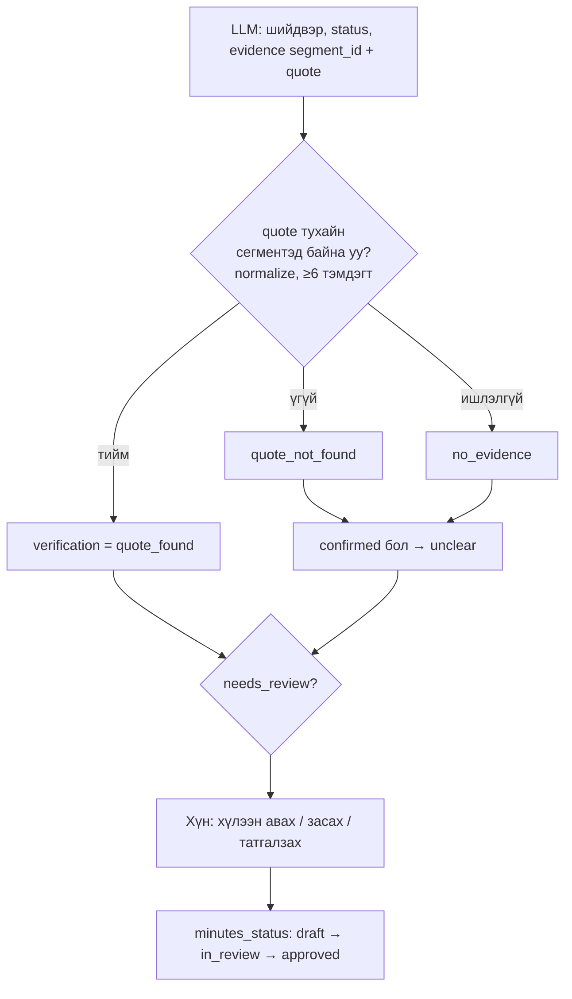

# AI тэмдэглэл

**MN** · [EN](en/ai-minutes.md)

> 7 мин унших · Эх сурвалж: `app/services/{asr,llm,minutes_verify,minutes_review,ask,vocabulary,speakers,notes}.py`, `eval/`

## 01 Provider-ууд

| Үүрэг | Тохиргоо | Сонголт | Production |
|---|---|---|---|
| ASR (яриа → текст) | `ASR_PROVIDER` | `omni` · `whisper` · `demo` | `omni`, `OMNI_MODEL=qwen3.8-omni-flash` |
| LLM (тэмдэглэл, Ask) | `LLM_PROVIDER` | `qwen` · `demo` | `qwen`, `QWEN_MODEL=qwen3.8-max` |

- Qwen-ийг OpenAI-compatible API-аар дуудна. `QWEN_BASE_URL=https://tokenhub.mn/v1` (Гэрэгэ Token Hub) эсвэл DashScope шууд.
- `demo` — гадагш дуудахгүй, `[ДЕМО]` шошготой үр дүн. Тест, staging, smoke-д.
- `whisper` — локал, 2 GB+ RAM; Render free-д багтахгүй. Стандарт Whisper монгол хэлийг муу таньдаг.
- `QWEN_ENABLE_THINKING=false` — асаавал ~10–20 дахин удаашрана.

## 02 ASR (`asr.py`)

- Аудиог **нэг удаа** mono FLAC болгоод 30 сек (`OMNI_CHUNK_SEC`) хэсгүүдээр, зэрэг 4 хүсэлтээр (`ASR_CONCURRENCY`) явуулна.
- Prompt-д хурлын **сэдэв**, оролцогчдын нэр, хэрэглэгчийн **толь бичгийн** үгсийг өгнө (`ASRContext.hints`).
- Хэсэг бүр "Яригч 1/2" шошготой мөрүүд буцаана → `speakers.parse_turns` сегмент доторх ярианд (turns) задална.
- Дараа нь хэрэглэгчийн өмнөх **"Үг засах"** засваруудыг автоматаар хэрэгжүүлнэ.

## 03 Тэмдэглэл гаргах (`llm.py`)

Хэрэглэгчийн мессеж: дугаарласан бичвэр (`[segment_id] mm:ss Яригч: текст`) + доорх нэмэлтүүд:

| Нэмэлт | Эх | Нөлөө |
|---|---|---|
| Оролцогчид | хурлын `participants` | "Яригч 2" → бодит нэр |
| Загвар | `meeting_templates` | заавар + зөвхөн сонгосон хэсгүүд (`apply_template_sections` бусдыг хоосолно) |
| Хэл | `meetings.language` | `en` бол англиар (JSON түлхүүр өөрчлөгдөхгүй) |
| Гар тэмдэглэл | `meetings.notes` (цэвэрлэсэн HTML → текст) | ASR алдаа, сонсогдоогүй хэсгийг нөхнө |

Хариу: `MeetingMinutes` JSON — `title, summary, topics, decisions, action_items, open_questions, qa, participants, speaker_map`.
Боловсруулалтын дараа:
1. `drop_unknown_sources` — байхгүй сегмент рүү заасан эх сурвалжийг хасна.
2. `verify_minutes` — ишлэлийг шалгана (доор).
3. `speaker_map`-аар хэсэг бүрийн "Яригч N"-ийг хурлын хэмжээний яригч болгоод хоосолно.

**Хураангуйг дангаар** (`POST /regenerate-summary`) — богино prompt, зөвхөн `summary` талбарт хүрнэ.

## 04 Ишлэлийн шалгалт ба батлалт



| Баталгаа | Хүч |
|---|---|
| Санал нь шийдвэр болж харагдахгүй (`proposed` тусад нь) | prompt + харуулах дүрэм |
| `confirmed` ишлэлгүй бол `unclear` болно | кодоор, тодорхой |
| AI тэмдэглэл хүн батлах хүртэл ноорог; батлагдсаны дараа өөрчлөгдвөл `in_review` | кодоор |
| Батлагдаагүй экспорт анхааруулгатай | кодоор |

UI "**иш татсан**" гэж бичнэ, "баталгаажсан" биш: ишлэл олдсон нь эх текст байгааг л батална, дүгнэлт зөв гэдгийг биш.
Дэлгэрэнгүй: [AI_QUALITY.md](AI_QUALITY.md).

## 05 Ask Minuto (`ask.py`)

1. Хэрэглэгчийн сүүлийн 200 хурлын (эсвэл нэг хурлын) бичвэр, хураангуйг ачаална.
2. 60 000 тэмдэгтэд багтвал бүгдийг, үгүй бол асуулттай давхцсан хэсгүүдийг хөршийн хамт сонгоно
   (монгол үгийн нөхцөл хасах, синоним, BM25 төст оноо).
3. Хэсэг бүр `[S12]` шошготой; LLM хариултдаа шошгоор эх сурвалжаа заана → хурал, сегмент, цаг руу хөрвүүлнэ.
4. Зохиосон шошгыг хасна. Мэдээлэл байхгүй бол: *"Хурлын бичвэрээс энэ талаар мэдээлэл олдсонгүй."*
5. Сүүлийн 6 ээлжийн яриаг контекстэд авна.

## 06 Чанарын үнэлгээ (eval)

**Prompt, загвар солих бүрд өмнө/дараах тоо гаргана.**

```bash
python -m eval.run_eval --provider file:eval/canned/good_model_outputs.json      # үнэгүй
python -m eval.run_eval --provider qwen --out before.json                         # ТӨЛБӨРТЭЙ
python -m eval.run_eval --provider qwen --baseline before.json --out after.json
python -m eval.compare_models eval/fixtures_models qwen3.7-plus,qwen3.8-max 2 out/  # ТӨЛБӨРТЭЙ
```

Хэмжүүр: шийдвэрийн precision/recall, **false_confirmed** (санал → батлагдсан шийдвэр, хамгийн муу алдаа),
даалгаврын хариуцагч/хугацааны нарийвчлал, **hallucination**, evidence_found_rate.

2026-11-18: `qwen3.8-max` нь `qwen3.7-plus`-аас шийдвэрийн precision өндөр (0.50 vs 0.28), hallucination бага (1.5 vs 1.8),
~12% удаан → production `qwen3.8-max` болсон. Тестийн өгөгдөл **synthetic** — бодит хурал дээр хэмжээгүй.

## 07 Хэрэглэгчийн толь бичиг (`vocabulary.py`)
- `POST /api/vocabulary` — нэр томьёо (заавал биш "буруу хувилбар"-тай).
- Бичвэрт "Үг засах" (`/transcript/replace`) хийхэд засвар автоматаар толь бичигт хадгалагдана.
- Дараагийн хурал бүрд: үгс ASR prompt-д, засварууд шинэ бичвэрт автоматаар.
