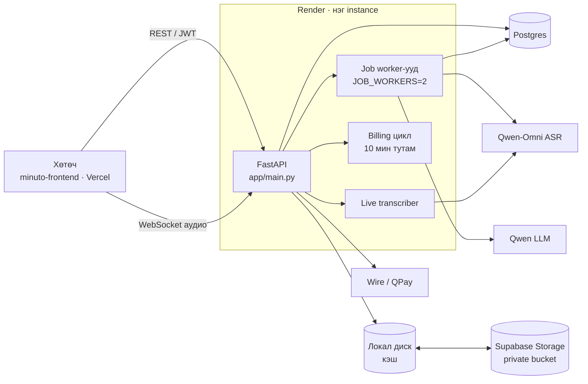
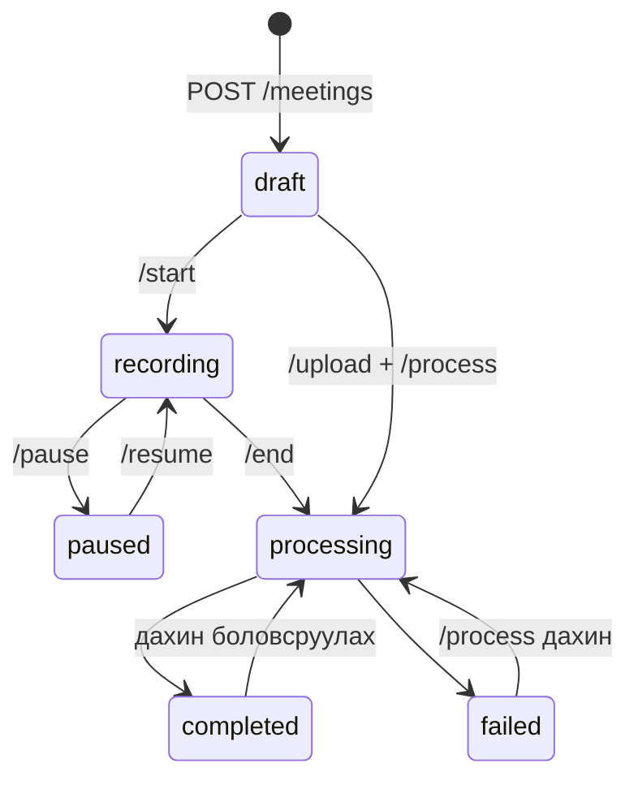
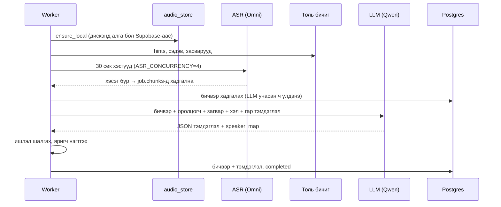

# Архитектур

**MN** · [EN](en/architecture.md)

> 8 мин унших · Эх сурвалж: `app/main.py`, `app/services/{processing,jobs,asr,llm,live_transcriber,audio_store,audio_ingest}.py`

## 01 Ерөнхий зураг

**Нэг процесс бүгдийг хийдэг:** HTTP API, WebSocket, ард боловсруулах worker, шууд бичвэр, billing-ийн цикл.
Шууд бичлэгийн төлөв, WS ticket, rate limiter санах ойд байдаг тул **нэгээс олон instance болгож болохгүй**.

### Эхлэх үед (`lifespan`)
1. Production-д `JWT_SECRET` байхгүй бол зогсоно; `AUDIO_STORAGE_BACKEND` буруу бол зогсоно.
2. `db.configure()` → Alembic `upgrade head` (Postgres advisory lock-той).
3. `jobs.recover_on_startup()` → унасан ажлыг үргэлжлүүлнэ.
4. Worker-ууд, 10 минутын арын цикл (billing reconcile, pending төлбөр, хогийн сав цэвэрлэх, аудио устгалын давталт).

## 02 Хурлын амьдралын мөчлөг

Нэмэлт тэмдэглэгээ (төлөв биш): `archived`, `pinned_at`, `deleted_at` (хогийн сав).

## 03 Боловсруулах урсгал (`processing.run`)

Явц `meetings.processing_stage` (`transcribing` → `summarizing`, эсвэл `retrying`) ба `processing_done/total`-д бичигдэнэ;
frontend түүнийг асууж харуулна.

**Алдааны код** (`processing_error`, хэрэглэгчид харагдана): `NO_AUDIO`, `NO_SPEECH`, `ASR_FAILED`, `SUMMARY_FAILED`,
`DISK_FULL`, `INTERNAL_ERROR`. Provider-ийн дэлгэрэнгүй текст зөвхөн логт.

## 04 Durable ажлын дараалал (`jobs.py`, migration 0004)

| Шинж | Хэрхэн |
|---|---|
| Давхардал | Нэг хуралд зэрэг ганц идэвхтэй ажил (DB unique guard). Давхар `POST /process` → нэг ажил |
| Lease | Worker `JOB_HEARTBEAT_SEC=30` тутам lease сунгана; `JOB_LEASE_SEC=120` тасарвал өөр worker авна |
| Дахин оролдох | Зөвхөн provider-ийн түр алдаа ба диск дүүрэлт. `JOB_MAX_ATTEMPTS=3`, backoff 2× (≤120 сек) |
| Үргэлжлүүлэх | Дууссан ASR хэсэг бүр `processing_jobs.chunks`-д → дахин эхлэхэд дахин төлөхгүй |
| Restart | Deploy-ийн үеэр ажиллаж байсан ажил `running` хэвээр үлдэж, дараагийн эхлэлд үргэлжилнэ |

## 05 Шууд бичлэг (`websocket.py`, `audio_ingest.py`, `live_transcriber.py`)

1. Frontend `POST /meetings/{id}/ws-ticket` → 60 сек настай нэг удаагийн ticket.
2. `WS /ws/meetings/{id}/audio?ticket=…`. Origin шалгана (CSWSH).
3. Хэсэг бүр: JSON `{"type":"audio.chunk","sequence":N,…}` дараа нь binary. Сервер дискэнд бичээд `audio.ack`.
   Ижил sequence дахин ирвэл дарж бичнэ — дахин холболтод аюулгүй.
4. Live transcriber хэсгүүдийг нэг ffmpeg процесс руу дамжуулж 16 kHz PCM болгоно, **чимээгүй хэсэг дээр** 10–25 сек
   цонхонд таслаж ASR руу явуулаад `transcript.segment` болгон бүх холболт руу түгээнэ. Чимээгүй цонхыг илгээхгүй.
5. `/end` дээр хэсгүүд нэг файл болж Supabase руу хуулагдана, бүтэн боловсруулалт эхэлнэ.
   Шууд бичвэр нь зөвхөн урьдчилсан; эцсийн бичвэр бүтэн аудиогоос дахин гарна.

## 06 Аудио хадгалалт (`audio_store.py`, migration 0008)

- **Диск = кэш, Supabase = эх.** `AUDIO_STORAGE_BACKEND=local` (default) үед зөвхөн диск — deploy бүрт арилна.
- `persist` — эцсийн файлыг remote руу; `ensure_local` — дискэнд алга бол татна; `purge` — хоёуланг нь устгана,
  remote амжилтгүй бол `audio_purges`-д бүртгэж 10 мин тутам дахин оролдоно.
- Шууд бичлэгийн хэсгүүд зөвхөн дискэнд — бичлэгийн *дундуур* restart болвол алдагдана.

## 07 Хамгаалалт (`upload_guard.py`, `security.py`)

| Хязгаар | Default |
|---|---|
| Нэг upload | 300 MB, 4 цаг (`MAX_UPLOAD_BYTES`, `MAX_RECORDING_SEC`) |
| Шууд бичлэг нийт | 400 MB |
| Хэрэглэгчийн квот | өдөрт 2 GB, нийт 10 GB |
| Дискний доод зай | 500 MB-аас бага бол шинэ аудио татгалзана |
| Rate limit | IP-д 120/мин, нэвтрэлт 10/мин, AI үйлдэл хэрэглэгчид 20/мин |

Файлын төрлийг толгойн байтаар (sniff) шалгана, уртыг ffmpeg-ээр уншина.
Хариу бүр `X-Request-ID`-тэй; JSON access log-д query string, header, бие, бичвэр **бичигдэхгүй**.

## 08 Өгөгдлийн загвар (`app/db.py`)

| Хүснэгт | Агуулга |
|---|---|
| `users` | имэйл, нууц үгийн hash, нэр, `token_version`, `google_sub` |
| `meetings` | төлөв, цаг, `transcript` (JSON), `minutes` (JSON), оролцогч, гар тэмдэглэл, загвар, workspace/project |
| `transcript_revisions` | бичвэрийн засварын түүх |
| `processing_jobs` | ажлын дараалал, lease, ASR хэсгүүд |
| `workspaces` · `workspace_members` · `projects` | баг, үүрэг, төсөл |
| `meeting_templates` · `vocabulary_terms` · `contacts` | загвар, толь бичиг, оролцогчдын нэрийн сан |
| `plans` · `subscriptions` · `usage_events` · `payment_orders` | billing |
| `contact_requests` · `admin_grants` · `audio_purges` | Enterprise хүсэлт, нэмэлт админ, устгалын давталт |

Бичвэр, тэмдэглэл нь `meetings` дотор JSON — хурлыг нэг мөрөөр уншина. Тэмдэглэлийн бүтэц: `app/models/minutes.py`.
