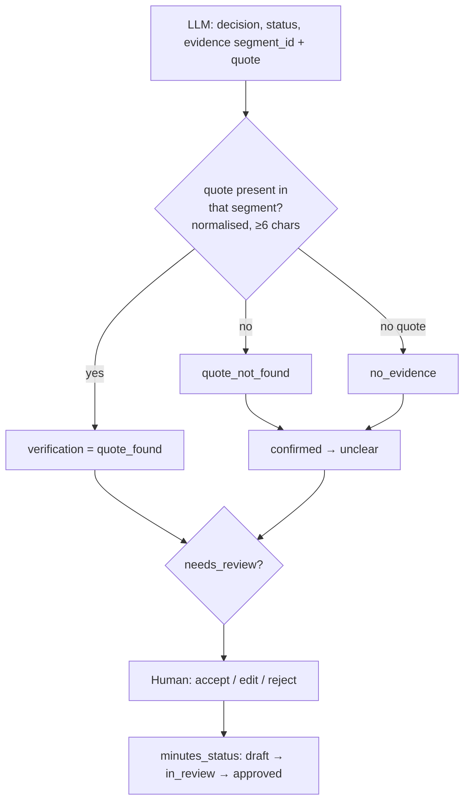

# AI minutes

[MN](../ai-minutes.md) · **EN**

> 7 min read · Source: `app/services/{asr,llm,minutes_verify,minutes_review,ask,vocabulary,speakers,notes}.py`, `eval/`

## 01 Providers

| Role | Setting | Options | Production |
|---|---|---|---|
| ASR (speech → text) | `ASR_PROVIDER` | `omni` · `whisper` · `demo` | `omni`, `OMNI_MODEL=qwen3.8-omni-flash` |
| LLM (minutes, Ask) | `LLM_PROVIDER` | `qwen` · `demo` | `qwen`, `QWEN_MODEL=qwen3.8-max` |

- Qwen is called through an OpenAI-compatible API. `QWEN_BASE_URL=https://tokenhub.mn/v1` (Gerege Token Hub) or DashScope directly.
- `demo` — no external calls, output labelled `[ДЕМО]`. For tests, staging and smoke runs.
- `whisper` — local, 2 GB+ RAM; does not fit Render free. Stock Whisper handles Mongolian poorly.
- `QWEN_ENABLE_THINKING=false` — turning it on makes responses ~10–20× slower.

## 02 ASR (`asr.py`)

- Audio is converted **once** to mono FLAC, then sent in 30 s chunks (`OMNI_CHUNK_SEC`), 4 requests in parallel (`ASR_CONCURRENCY`).
- The prompt includes the meeting **topic**, participant names and the user's **vocabulary** terms (`ASRContext.hints`).
- Each chunk returns lines labelled "Яригч 1/2" (Speaker 1/2) → `speakers.parse_turns` splits them into turns within a segment.
- The user's earlier **find & replace** corrections are then applied automatically.

## 03 Generating minutes (`llm.py`)

User message: the numbered transcript (`[segment_id] mm:ss Speaker: text`) plus these additions:

| Addition | Source | Effect |
|---|---|---|
| Participants | meeting `participants` | "Speaker 2" → real name |
| Template | `meeting_templates` | instructions + only the selected sections (`apply_template_sections` empties the rest) |
| Language | `meetings.language` | `en` → minutes in English (JSON keys unchanged) |
| Facilitator's notes | `meetings.notes` (sanitised HTML → text) | fills ASR errors and inaudible parts |

Response: `MeetingMinutes` JSON — `title, summary, topics, decisions, action_items, open_questions, qa, participants, speaker_map`.
After the call:
1. `drop_unknown_sources` — removes source references to segments that do not exist.
2. `verify_minutes` — checks the quotes (below).
3. `speaker_map` turns per-chunk "Speaker N" labels into meeting-wide speakers, then is cleared.

**Summary only** (`POST /regenerate-summary`) — a short prompt that touches only the `summary` field.

## 04 Quote verification and approval



| Guarantee | Strength |
|---|---|
| A proposal never appears as a decision (`proposed` listed separately) | prompt + display rule |
| `confirmed` without a found quote becomes `unclear` | code, deterministic |
| AI minutes stay a draft until a person approves; changes after approval → `in_review` | code |
| Unapproved exports carry a notice | code |

The UI says "**cited**", never "verified": a found quote proves the source text exists, not that the conclusion is right.
Details: [AI_QUALITY.md](../AI_QUALITY.md).

## 05 Ask Minuto (`ask.py`)

1. Loads transcripts and summaries of the user's latest 200 meetings (or one meeting).
2. If they fit in 60,000 characters, uses all of them; otherwise picks the passages that match the question, with neighbours
   (Mongolian suffix stripping, synonyms, BM25-like scoring).
3. Each passage is labelled `[S12]`; the LLM cites its sources by label → mapped back to meeting, segment and time.
4. Invented labels are removed. If nothing is found: *"Хурлын бичвэрээс энэ талаар мэдээлэл олдсонгүй."* (No information in the transcripts.)
5. The last 6 conversation turns are kept as context.

## 06 Quality evaluation (eval)

**Every prompt or model change ships with before/after numbers.**

```bash
python -m eval.run_eval --provider file:eval/canned/good_model_outputs.json      # free
python -m eval.run_eval --provider qwen --out before.json                         # PAID
python -m eval.run_eval --provider qwen --baseline before.json --out after.json
python -m eval.compare_models eval/fixtures_models qwen3.7-plus,qwen3.8-max 2 out/  # PAID
```

Metrics: decision precision/recall, **false_confirmed** (a proposal reported as a confirmed decision — the worst error),
action-item owner/due-date accuracy, **hallucinations**, evidence_found_rate.

2026-11-18: `qwen3.8-max` beat `qwen3.7-plus` on decision precision (0.50 vs 0.28) with fewer hallucinations (1.5 vs 1.8),
~12% slower → production switched to `qwen3.8-max`. The test data is **synthetic** — not measured on real meetings.

## 07 User vocabulary (`vocabulary.py`)
- `POST /api/vocabulary` — a term (optionally with its "wrong" spelling).
- A find & replace on a transcript (`/transcript/replace`) saves the correction to the vocabulary automatically.
- For every later meeting: terms go into the ASR prompt, corrections are applied to the new transcript.
