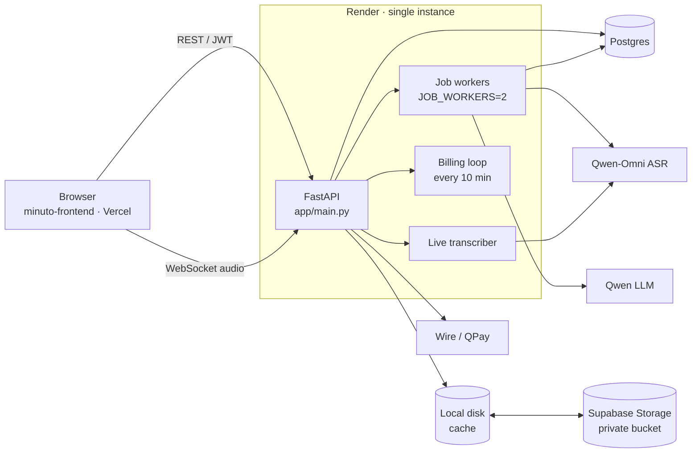
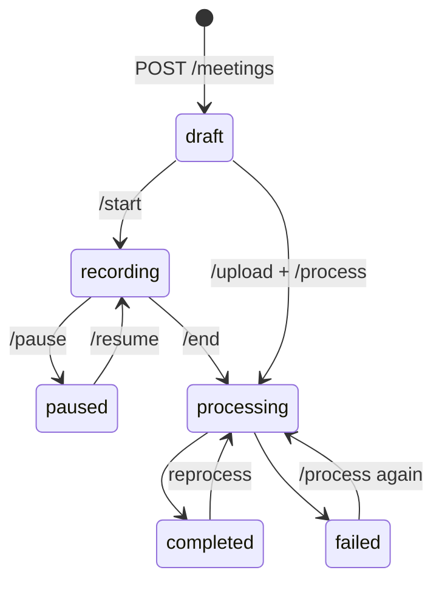
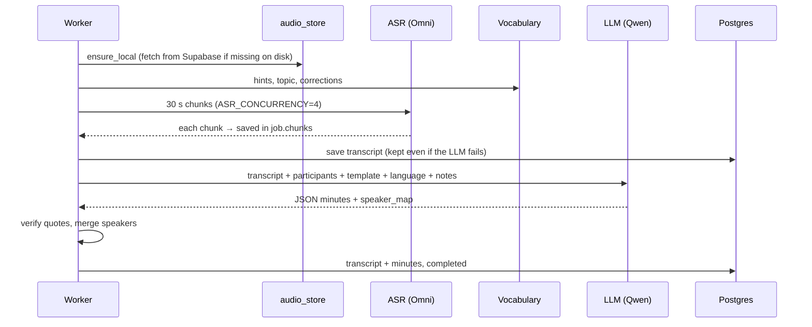

# Architecture

[MN](../architecture.md) · **EN**

> 8 min read · Source: `app/main.py`, `app/services/{processing,jobs,asr,llm,live_transcriber,audio_store,audio_ingest}.py`

## 01 Big picture

**One process does everything:** HTTP API, WebSocket, background workers, live transcription, the billing loop.
Live recording state, WS tickets and the rate limiter live in memory, so **do not run more than one instance**.

### On startup (`lifespan`)
1. In production, stop if `JWT_SECRET` is missing; stop if `AUDIO_STORAGE_BACKEND` is misconfigured.
2. `db.configure()` → Alembic `upgrade head` (with a Postgres advisory lock).
3. `jobs.recover_on_startup()` → resumes interrupted jobs.
4. Workers and a 10-minute background loop (billing reconcile, pending payments, trash purge, audio deletion retries).

## 02 Meeting lifecycle

Extra flags (not states): `archived`, `pinned_at`, `deleted_at` (trash).

## 03 Processing flow (`processing.run`)

Progress is written to `meetings.processing_stage` (`transcribing` → `summarizing`, or `retrying`) and `processing_done/total`;
the frontend polls it.

**Error codes** (`processing_error`, shown to users): `NO_AUDIO`, `NO_SPEECH`, `ASR_FAILED`, `SUMMARY_FAILED`,
`DISK_FULL`, `INTERNAL_ERROR`. Provider details go to the log only.

## 04 Durable job queue (`jobs.py`, migration 0004)

| Property | How |
|---|---|
| Deduplication | One active job per meeting (DB unique guard). A double `POST /process` → one job |
| Lease | A worker extends its lease every `JOB_HEARTBEAT_SEC=30`; if it stops for `JOB_LEASE_SEC=120`, another worker takes over |
| Retries | Only transient provider errors and full disk. `JOB_MAX_ATTEMPTS=3`, backoff doubles (≤120 s) |
| Resume | Every finished ASR chunk is saved in `processing_jobs.chunks` → no paying twice on resume |
| Restart | A job running during a deploy stays `running` and continues on the next startup |

## 05 Live recording (`websocket.py`, `audio_ingest.py`, `live_transcriber.py`)

1. The frontend calls `POST /meetings/{id}/ws-ticket` → a one-time ticket valid for 60 s.
2. `WS /ws/meetings/{id}/audio?ticket=…`. The Origin is checked (CSWSH).
3. Per chunk: JSON `{"type":"audio.chunk","sequence":N,…}` then binary. The server writes it to disk and replies `audio.ack`.
   A repeated sequence overwrites — safe for reconnects.
4. The live transcriber pipes chunks into one ffmpeg process as 16 kHz PCM, cuts 10–25 s windows **at silences**,
   sends them to ASR and broadcasts `transcript.segment` to all connections. Silent windows are not sent.
5. On `/end` the chunks are merged into one file, copied to Supabase, and full processing starts.
   The live transcript is preliminary; the final transcript is produced again from the full audio.

## 06 Audio storage (`audio_store.py`, migration 0008)

- **Disk = cache, Supabase = source of truth.** With `AUDIO_STORAGE_BACKEND=local` (default) there is only the disk — wiped on every deploy.
- `persist` — final file to remote; `ensure_local` — download if missing on disk; `purge` — delete both,
  recording failed remote deletes in `audio_purges` and retrying every 10 minutes.
- Live-recording chunks exist only on disk — a restart *during* a recording loses them.

## 07 Protection (`upload_guard.py`, `security.py`)

| Limit | Default |
|---|---|
| Single upload | 300 MB, 4 hours (`MAX_UPLOAD_BYTES`, `MAX_RECORDING_SEC`) |
| Live recording total | 400 MB |
| Per-user quota | 2 GB/day, 10 GB total |
| Minimum free disk | new audio refused below 500 MB |
| Rate limits | 120/min per IP, sign-in 10/min, AI actions 20/min per user |

File type is detected from the leading bytes (sniffing); duration is read with ffmpeg.
Every response carries `X-Request-ID`; the JSON access log **never** contains query strings, headers, bodies or transcripts.

## 08 Data model (`app/db.py`)

| Table | Contents |
|---|---|
| `users` | email, password hash, name, `token_version`, `google_sub` |
| `meetings` | status, times, `transcript` (JSON), `minutes` (JSON), participants, notes, template, workspace/project |
| `transcript_revisions` | transcript edit history |
| `processing_jobs` | job queue, leases, ASR chunks |
| `workspaces` · `workspace_members` · `projects` | teams, roles, projects |
| `meeting_templates` · `vocabulary_terms` · `contacts` | templates, vocabulary, participant name book |
| `plans` · `subscriptions` · `usage_events` · `payment_orders` | billing |
| `contact_requests` · `admin_grants` · `audio_purges` | Enterprise requests, extra admins, deletion retries |

Transcript and minutes are JSON inside `meetings` — a meeting is read as one row. Minutes structure: `app/models/minutes.py`.
