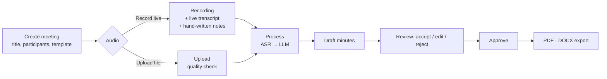

# Product

[MN](../product.md) · **EN**

> 6 min read · New · Source: `app/api/`, `app/services/`, `minuto-frontend/src/app/`

**Minuto** is an AI assistant that records Mongolian-language meetings (or accepts an audio file), transcribes the speech
and turns it into **formal meeting minutes with decisions, action items and open questions**.
Everything the AI produces is a **draft**: nothing shows as "approved" until a person reviews and approves it.

## 01 What problem it solves

| Today | With Minuto |
|---|---|
| A secretary takes notes by hand and spends hours tidying them up | A draft of the minutes is ready when the meeting ends |
| "We decided this" depends on who remembers it | Every decision **cites** a specific part of the transcript |
| Who owns a task and by when gets lost | Every action item has an owner, a due date and a status |
| Finding something from a past meeting means reading every set of minutes | Ask "Ask Minuto" and get an answer with the meeting and timestamp |
| Foreign tools recognise Mongolian poorly | Prompts tuned for Mongolian, plus a per-user vocabulary |

**For:** government organisations, company management and project meetings, teams that run interviews and trainings.

## 02 User flow

## 03 Features

### Recording and audio
- **Live recording** from the browser (WebSocket). Pause / resume. If the connection drops, the client reconnects and resends missing chunks.
- **Live transcript**: text appears on screen every 10–25 seconds while the meeting runs (`LIVE_TRANSCRIPTION`).
- **File upload**: webm, ogg, mp3, m4a/mp4, wav, flac, aac, amr — up to 300 MB and 4 hours.
- **Audio quality warning**: silent, too quiet, clipping or noisy recordings are flagged on upload.
- Audio playback; clicking a transcript line jumps to that moment.

### Transcript
- Every segment has a timestamp and a speaker. Speaker names can be changed.
- **Editing** per line, edit **history** with restore, conflict detection when two people edit at once (ETag).
- **Find & replace**: "wrong → right" across the whole transcript. The correction is saved to the vocabulary and applied automatically to future meetings.
- **Vocabulary**: organisation names, terminology and people's names are given to the ASR up front.

### AI meeting minutes
- Title, **summary**, topics discussed, **decisions**, **action items**, open questions, Q&A, participants.
- Every decision has a status: `confirmed` / `proposed` / `rejected` / `unclear`. A proposal never shows as a decision.
- Citations: the AI quotes the transcript verbatim; the system checks that the quote **really exists** in the transcript.
- **Facilitator's notes** written during the meeting (bold, italic, lists) — used when generating the minutes.
- **Templates**: Formal meeting, Daily Standup, Brainstorming, Interview, Training/Lecture, Project status + custom templates.
- Minutes in Mongolian or English. The summary can be regenerated on its own.
- Topic segmentation (splits the transcript into timed sections).

### Review and approval
- Minutes status: `Draft → In review → Approved`. Approval right: owner/admin.
- Accept / edit / reject each item. If content changes after approval, the status drops back to "In review".
- Unapproved exports carry an "AI-generated, not approved" notice.

### Export
- **PDF** — official A4 letter format: title, date, time, attendees, agenda, decisions, action items, signature.
- **DOCX** — editable Word document including the full transcript.

### Ask Minuto
Ask questions across all of your meetings (or one): *"What did we decide about the budget?"* The answer cites the meeting
and timestamp; if the transcript does not contain it, Minuto says "no information found" instead of making something up.

### Action items list
All action items from all meetings in one place: owner, due date, status (`open`, `in progress`, `done`, `cancelled`).

### Teams (Workspaces)
- A personal space + organisation workspaces. Invite members with roles: **owner, admin, editor, viewer**.
- Projects inside a workspace group its meetings.
- Non-members cannot see a workspace's meetings at all.

### Meeting list
Search, "Pin" (shown at the top), archive, trash (kept for 30 days on paid plans, restorable).

## 04 Plans and pricing

| Plan | Minutes | Period | Price | For |
|---|---|---|---|---|
| Free | 30 | one-time | ₮0 | Individual |
| Starter | 120 | 30 days | ₮9,900 | Individual |
| Pro | 360 | 30 days | ₮24,900 | Individual |
| Team | 900 | 30 days | ₮59,900 | Workspace |
| Enterprise | by contract | – | quote | Organisation |

- Unit: minutes of processed audio (rounded up per meeting). Reprocessing the same audio is free.
- Payment: Wire → **QPay** and other bank apps. Plans do not auto-renew.
- Trash is paid plans only; on Free, deleted meetings are removed immediately.
- Full rules: [Billing](../BILLING.md) (Mongolian).

## 05 Sign-in
Email + password, or **Sign in with Google**. "Sign out of all devices" is available.

## 06 Security and privacy (short)
- A meeting is visible only to its owner and members of its workspace.
- Audio is stored in a private bucket and played through short-lived signed links.
- Logs never contain transcripts, headers or query strings.
- Audio and transcripts are sent to the AI provider (Qwen, via Gerege Token Hub) for processing.

## 07 Current limitations
- Speaker separation is text-based, not acoustic — in long meetings the same person can get different labels ([Diarization](../DIARIZATION.md)).
- Minutes accuracy has not yet been measured on real Mongolian meetings (synthetic eval only).
- Designed to run as a single instance.
- Refund and upgrade price-difference rules are not decided yet.
