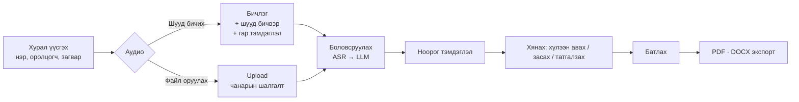

# Бүтээгдэхүүн

**MN** · [EN](en/product.md)

> 6 мин унших · Шинэ · Эх сурвалж: `app/api/`, `app/services/`, `minuto-frontend/src/app/`

**Minuto** нь монгол хэл дээр болсон хурлыг бичиж (эсвэл файл хүлээн авч), ярианаас текст гаргаж,
**шийдвэр, үүрэг даалгавар, нээлттэй асуудалтай албан ёсны хурлын тэмдэглэл** болгодог AI туслах юм.
AI-ийн гаргасан бүх зүйл **ноорог**: хүн хянаж батлах хүртэл "батлагдсан" гэж харагдахгүй.

## 01 Ямар асуудал шийддэг вэ

| Өнөөдөр | Minuto-той |
|---|---|
| Хурлын нарийн бичиг гараар тэмдэглэж, дараа нь цагаар бичиж цэгцэлнэ | Хурал дуусахад тэмдэглэлийн ноорог бэлэн |
| "Ингэж шийдсэн" гэдэг нь хэний санаж буйгаас хамаарна | Шийдвэр бүр бичвэрийн тодорхой хэсгийг **иш татна** |
| Даалгавар хэнд, хэзээ гэдэг тодорхойгүй алга болно | Даалгавар бүр хариуцагч, хугацаа, төлөвтэй |
| Өнгөрсөн хурлаас мэдээлэл хайхад бүх тэмдэглэлийг уншина | "Ask Minuto"-д асуухад хурал, цагтай нь хариулна |
| Гадаадын хэрэгслүүд монгол хэлийг муу таньдаг | Монгол хэлэнд тохируулсан prompt, хэрэглэгчийн толь бичиг |

**Хэнд:** төрийн байгууллага, компанийн удирдлагын болон төслийн хурал, ярилцлага, сургалт хийдэг баг.

## 02 Хэрэглэгчийн урсгал

## 03 Боломжууд

### Бичлэг ба аудио
- **Шууд бичлэг** хөтчөөс (WebSocket). Түр зогсоох / үргэлжлүүлэх. Сүлжээ тасарвал дахин холбогдоод дутуу хэсгээ дахин илгээнэ.
- **Шууд бичвэр**: хурал явж байхад 10–25 секунд тутам ярианы текст дэлгэц дээр гарна (`LIVE_TRANSCRIPTION`).
- **Файл оруулах**: webm, ogg, mp3, m4a/mp4, wav, flac, aac, amr — 300 MB, 4 цаг хүртэл.
- **Аудионы чанарын анхааруулга**: чимээгүй, хэт нам, хэт чанга (clipping), шуугиантай бичлэгийг оруулах үед мэдэгдэнэ.
- Аудиог тоглуулж, бичвэрийн мөр дээр дарж тухайн цаг руу очно.

### Бичвэр (transcript)
- Сегмент бүр цаг, яригчтай. Яригчийн нэрийг өөрчилж болно.
- **Засварлах** (мөр бүрээр), засварын **түүх** ба сэргээх, нэг зэрэг хоёр хүн засахад зөрчлийг илрүүлнэ (ETag).
- **Үг солих**: бүх бичвэрт "буруу → зөв" солих. Засвар толь бичигт хадгалагдаж, дараагийн хуралд автоматаар хэрэгжинэ.
- **Толь бичиг**: байгууллагын нэр, нэр томьёо, хүний нэрийг ASR-д урьдчилан өгнө.

### AI хурлын тэмдэглэл
- Гарчиг, **хураангуй**, хэлэлцсэн сэдвүүд, **шийдвэр**, **үүрэг даалгавар**, нээлттэй асуулт, асуулт-хариулт, оролцогчид.
- Шийдвэр бүр төлөвтэй: `батлагдсан` / `санал` / `татгалзсан` / `тодорхойгүй`. Санал нь шийдвэр болж харагдахгүй.
- Ишлэл: AI бичвэрээс үгчлэн иш татна; систем тэр ишлэл бичвэрт **үнэхээр байгаа эсэхийг** шалгана.
- **Хөтлөгчийн гар тэмдэглэл** хурлын үеэр бичнэ (тод, налуу, жагсаалт) — AI тэмдэглэл гаргахдаа ашиглана.
- **Загвар**: Албан хурал, Daily Standup, Brainstorming, Ярилцлага, Сургалт/Лекц, Төслийн төлөв + өөрийн загвар.
- Монгол эсвэл англи хэлээр тэмдэглэл гаргана. Хураангуйг дангаар нь дахин үүсгэж болно.
- Сэдвээр хуваах (бичвэрийг цагийн хэсэгт хуваана).

### Хянах ба батлах
- Тэмдэглэлийн төлөв: `Ноорог → Хянаж буй → Батлагдсан`. Батлах эрх: эзэн/админ.
- Мөр бүрийг хүлээн авах / засах / татгалзах. Батлагдсаны дараа агуулга өөрчлөгдвөл "Хянаж буй" руу буцна.
- Батлагдаагүй экспорт "AI-ийн гаргасан, батлагдаагүй" гэсэн тэмдэглэгээтэй.

### Экспорт
- **PDF** — албан бичгийн A4 хэлбэр: гарчиг, огноо, цаг, бүрэлдэхүүн, хэлэлцсэн асуудал, шийдвэр, даалгавар, гарын үсэг.
- **DOCX** — засварлах боломжтой Word, бүтэн бичвэртэй.

### Ask Minuto
Өөрийн бүх (эсвэл нэг) хурлаас асуулт асууна: *"Төсвийн талаар юу шийдсэн бэ?"* Хариулт нь хурал, цагийн ишлэлтэй;
бичвэрт байхгүй бол "мэдээлэл олдсонгүй" гэж хариулна, зохиохгүй.

### Даалгаврын жагсаалт
Бүх хурлын даалгаврыг нэг дор: хариуцагч, хугацаа, төлөв (`нээлттэй`, `хийгдэж буй`, `дууссан`, `цуцалсан`).

### Багаар ажиллах (Workspace)
- Хувийн орон зай + байгууллагын workspace. Гишүүн урих, үүрэг: **эзэн, админ, засварлагч, үзэгч**.
- Workspace дотор төсөл (project)-өөр хурлуудыг ангилна.
- Гишүүн биш хүн workspace-ийн хурлыг огт харахгүй.

### Хурлын жагсаалт
Хайх, "Анхаарах" (pin) — дээр гарна, архивлах, хогийн сав (төлбөртэй багцад 30 хоног хадгална, сэргээж болно).

## 04 Багц ба үнэ

| Багц | Минут | Хугацаа | Үнэ | Хэнд |
|---|---|---|---|---|
| Free | 30 | нэг удаа | 0₮ | Хувь хүн |
| Starter | 120 | 30 хоног | 29,900₮ | Хувь хүн |
| Pro | 360 | 30 хоног | 69,900₮ | Хувь хүн |
| Team | 900 | 30 хоног | 149,900₮ | Workspace |
| Enterprise | гэрээгээр | – | үнийн санал | Байгууллага |

- Тоолох нэгж: боловсруулсан аудионы минут (хурал бүрээр дээш бүхэлчилнэ). Ижил аудиог дахин боловсруулах үнэгүй.
- Төлбөр: Wire → **QPay** болон бусад банкны апп. Хугацаа дуусахад автоматаар сунгахгүй.
- Хогийн сав зөвхөн төлбөртэй багцад; Free дээр устгасан хурал шууд устна.
- Дэлгэрэнгүй дүрэм: [Billing](BILLING.md).

## 05 Нэвтрэх
Имэйл + нууц үг, эсвэл **Google-ээр нэвтрэх**. "Бүх төхөөрөмжөөс гарах" боломжтой.

## 06 Аюулгүй байдал ба нууцлал (товч)
- Хурал зөвхөн эзэн болон workspace-ийн гишүүдэд харагдана.
- Аудио private bucket-д, богино настай гарын үсэгтэй холбоосоор тоглуулна.
- Логт бичвэр, header, query string бичигдэхгүй.
- Аудио, бичвэр AI provider (Qwen, Гэрэгэ Token Hub-аар) руу боловсруулахаар илгээгдэнэ.

## 07 Одоогийн хязгаарлалт
- Яригч ялгах нь акустик биш, текстэд тулгуурласан — урт хуралд ижил хүн өөр шошготой гарч болно ([Diarization](DIARIZATION.md)).
- Тэмдэглэлийн нарийвчлалыг бодит монгол хурал дээр хараахан хэмжээгүй (зөвхөн synthetic eval).
- Нэг серверт (single instance) ажиллахаар зохиосон.
- Буцаан олголт, багц ахиулалтын үнийн зөрүүний дүрэм батлагдаагүй.
